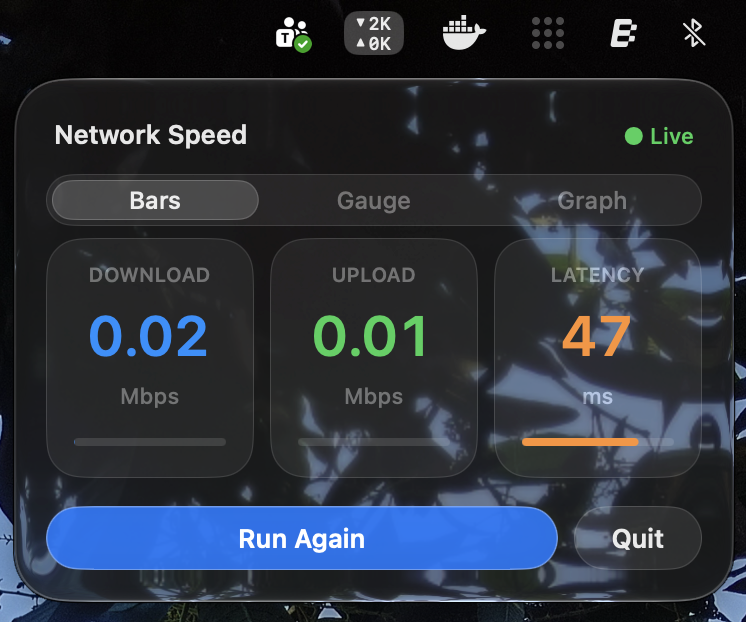
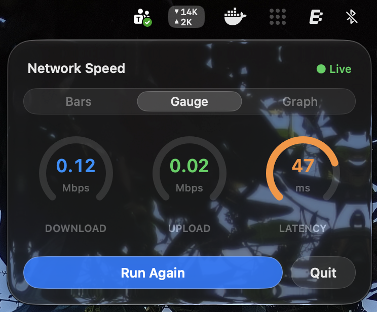
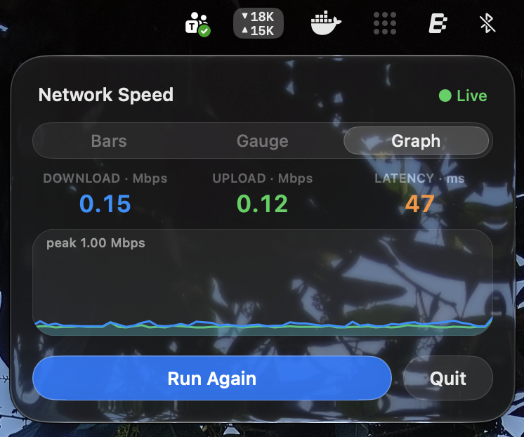
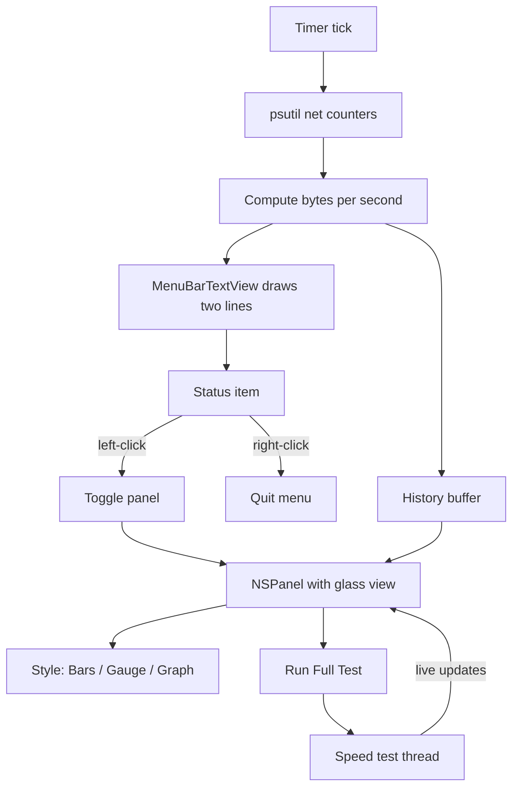
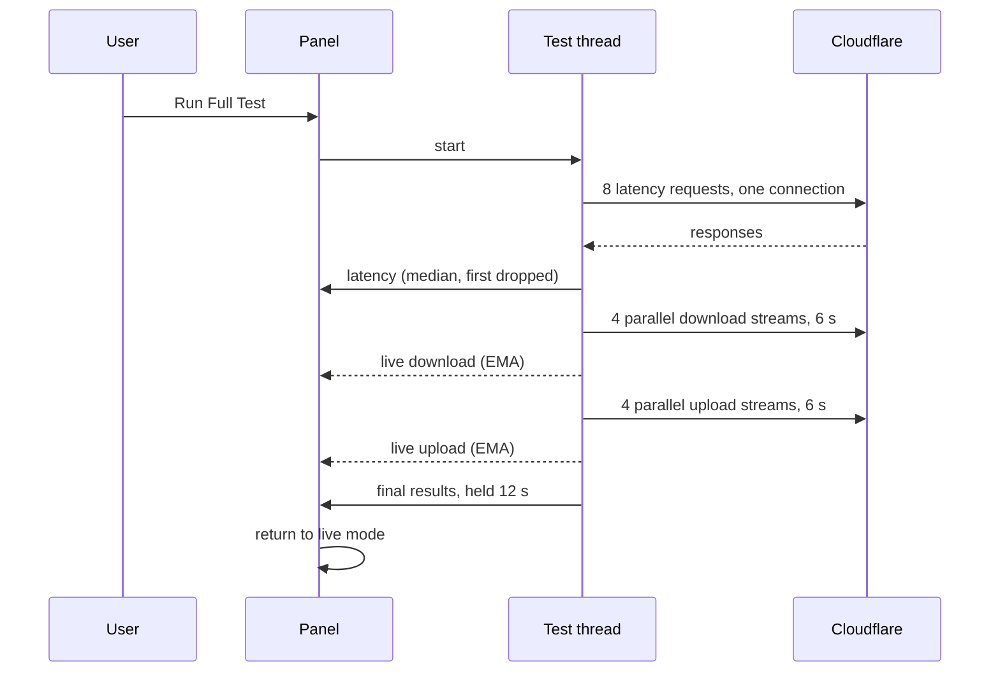

# Internet Speed Meter

A tiny macOS menu bar app that shows your live network speed, with a translucent **Liquid Glass** dashboard and a one-click speed test (latency, download, upload).



- Live download and upload speed, stacked in the menu bar
- Click for a glass dashboard with three styles: **Bars**, **Gauge**, **Graph**
- Built-in speed test powered by Cloudflare, with live updating numbers
- Single Python file, no Dock icon, low memory (about 37 MB idle)
- Runs as a plain script or as a standalone `.app`

---

## Contents

1. [Screenshots](#screenshots)
2. [Requirements](#requirements)
3. [Install and run (script)](#install-and-run-script)
4. [Using the app](#using-the-app)
5. [The speed test](#the-speed-test)
6. [Customising the look](#customising-the-look)
7. [Configuration reference](#configuration-reference)
8. [Build the .app yourself](#build-the-app-yourself)
9. [Download the .app](#download-the-app)
10. [How it works](#how-it-works)
11. [Memory and performance](#memory-and-performance)
12. [Troubleshooting](#troubleshooting)
13. [Design decisions](#design-decisions)
14. [Project structure](#project-structure)
15. [Privacy](#privacy)
16. [Contributing](#contributing)
17. [License](#license)

---

## Screenshots

| Bars | Gauge | Graph |
|---|---|---|
|  |  |  |

Menu bar item:


---

## Requirements

| | |
|---|---|
| OS | macOS (Apple Silicon). On macOS 26 and later the panel uses the native glass material. Older versions fall back to a blurred translucent panel. |
| Python | 3.11 (python.org install). Developed and tested on this version. |
| Packages | `rumps`, `psutil`, `pyobjc-framework-Cocoa`, `certifi` |

The `.app` build is Apple Silicon only, because the `psutil` wheels used are not universal.

---

## Install and run (script)

This is the recommended way to install.

```sh
git clone https://github.com/beingbrijesh/Internet-Speed-Meter.git
cd Internet-Speed-Meter
python3 -m venv .venv
source .venv/bin/activate
pip install -r requirements.txt
python3 speed_meter.py
```

Run it in the background, so the terminal is free:

```sh
python3 speed_meter.py --detach
```

Stop it any of these ways:

```sh
pkill -f speed_meter.py
```

or click **Quit** in the panel, or right-click the menu bar item and choose **Quit**.

> `--detach` is for the script only. It has no meaning inside the `.app`.
> `pkill -f speed_meter.py` only works if the file is really named `speed_meter.py`. It does not stop the built `.app`.

Only one copy runs at a time. A lock file `speed_meter.lock` in the system temp folder prevents duplicates.

---

## Using the app

| Action | Result |
|---|---|
| Left-click the menu bar item | Open or close the dashboard |
| Right-click the menu bar item | Show a menu with **Quit** |
| Click outside the panel | Close the panel |
| Style switch (top of panel) | Change between Bars, Gauge and Graph. Your choice is remembered. |
| **Run Full Test** | Start the speed test |
| **Quit** (panel) | Exit the app |

**Menu bar item.** Two stacked lines: a down arrow with download speed, and an up arrow with upload speed. Units are bytes per second (`K`, `M`). The item width follows the digits, and a rounded translucent pill appears while the panel is open.

**Panel.** A borderless, non-activating 360 x 262 panel. Speeds in the panel are shown in **Mbps**, and latency in **ms**.

---

## The speed test

Uses Cloudflare's public speed endpoints (`speed.cloudflare.com`, `/__down` and `/__up`).

| Stage | Method |
|---|---|
| Latency | 8 requests over one connection. The first is dropped (it includes connection setup) and the median of the rest is reported. |
| Download | 4 parallel streams for 6 seconds. Live display uses an exponential moving average. The final value is the average after the first second. |
| Upload | Same as download, in the other direction. |

When the test finishes, results stay on screen for 12 seconds, then the panel returns to live mode.

Tune the test with `TEST_DURATION`, `PARALLEL_STREAMS` and `RESULT_HOLD_SECONDS` at the top of `speed_meter.py`.

---

## Customising the look

The Liquid Glass look is controlled by three variables near the top of `speed_meter.py`.

| Variable | Applies to | Effect |
|---|---|---|
| `GLASS_TINT_ALPHA` (default `0.18`) | macOS 26+ | Main control. `0` is the most see-through, higher is more frosted. |
| `GLASS_CLEAR` (default `True`) | macOS 26+ | `True` is the clearer glass, `False` is regular glass. |
| `GLASS_ALPHA` (default `0.68`) | Older macOS | `1.0` is opaque blur, lower is clearer. |

Edit the value, save, then restart the app.

---

## Configuration reference

All tunables are plain constants at the top of `speed_meter.py`. Check the file for the exact current defaults.

| Variable | Purpose |
|---|---|
| `GLASS_TINT_ALPHA` | Frost amount on macOS 26+ (default 0.18) |
| `GLASS_CLEAR` | Clear or regular glass on macOS 26+ (default True) |
| `GLASS_ALPHA` | Panel opacity on older macOS (default 0.68) |
| `MENUBAR_FONT_SIZE` | Font size of the menu bar digits |
| `ARROW_FONT_SIZE` | Font size of the arrows |
| `MENUBAR_LINE_HEIGHT` | Vertical spacing of the two lines |
| `MENUBAR_GAP` | Gap between arrow and digits |
| `MENUBAR_PAD` | Horizontal padding of the menu bar item |
| `PILL_RADIUS` | Corner radius of the "selected" pill |
| `TICK_TOLERANCE` | Timer tolerance for the refresh tick |
| `PANEL_W`, `PANEL_H` | Panel size (default 360 x 262) |
| `TEST_DURATION` | Seconds per download and upload phase (default 6) |
| `PARALLEL_STREAMS` | Parallel connections in the test (default 4) |
| `RESULT_HOLD_SECONDS` | How long results stay visible (default 12) |
| `HISTORY_LEN` | Number of samples kept for the Graph style |

The selected panel style is stored in `NSUserDefaults` under the key `panelStyle`. To reset it:

```sh
defaults delete org.python.python panelStyle
```

(The exact domain depends on how you launch the app. The `.app` uses its own bundle identifier, `com.beingbrijesh.speedmeter`.)

---

## Build the .app yourself

Requires the project folder with `speed_meter.py` and `build_app.sh`.

```sh
chmod +x build_app.sh
./build_app.sh
```

The script:

1. Stops any running copy and removes old `build/`, `dist/`, the `.spec` file and the old zip
2. Reuses a build virtualenv at `~/speedmeter-build` and installs `pyinstaller rumps psutil pyobjc-framework-Cocoa certifi`
3. Runs PyInstaller (`--windowed`, bundle id `com.beingbrijesh.speedmeter`, hidden imports for `http.client`, `ssl`, `certifi`)
4. Sets `LSUIElement` in `Info.plist` so there is no Dock icon
5. Re-signs the bundle ad hoc (`codesign --force --deep --sign -`)
6. Packages `SpeedMeter-arm64.zip` and prints its SHA-256

Output: `dist/Speed Meter.app` and `SpeedMeter-arm64.zip`.

If the app does not appear in the menu bar, run it from the terminal to see the error:

```sh
"dist/Speed Meter.app/Contents/MacOS/Speed Meter"
```

A missing module usually means another `--hidden-import` is needed in `build_app.sh`.

To quit the built app, right-click the menu bar item and choose **Quit**.

---

## Download the .app

An optional prebuilt app is attached to each [GitHub Release](https://github.com/beingbrijesh/Internet-Speed-Meter/releases).

- Apple Silicon only
- **Ad-hoc signed and not notarized**, so macOS will warn you the first time
- The SHA-256 of each zip is listed in the release notes

Verify the download:

```sh
shasum -a 256 ~/Downloads/SpeedMeter-arm64.zip
```

Compare the result with the checksum in the release notes.

### Opening it the first time

1. Unzip and move `Speed Meter.app` to `/Applications`
2. Double-click it. macOS will say it cannot verify the app. Click **Done**.
3. Open **System Settings**, then **Privacy & Security**
4. Scroll down and click **Open Anyway** next to "Speed Meter", then confirm

Or remove the quarantine flag from the terminal:

```sh
xattr -dr com.apple.quarantine "/Applications/Speed Meter.app"
```

Removing the warning completely requires a paid Apple Developer ID and notarization, which this project does not use. If you prefer not to bypass Gatekeeper, use the script install instead.

### Start at login (optional)

Open **System Settings**, then **General**, then **Login Items**. Click **+** under "Open at Login" and choose `Speed Meter.app`.

---

## How it works



Speed test flow:



Key pieces:

- **`MenuBarTextView`**: a transparent custom view that draws the two menu bar lines and the selected pill.
- **Panel**: a borderless non-activating `NSPanel`. On macOS 26+ it hosts an `NSGlassEffectView`. On earlier versions it uses `NSVisualEffectView` with a faded alpha.
- **Sampling**: `psutil` network counters are read on a timer and converted to bytes per second.
- **Speed test**: runs off the main thread and posts live updates back to the UI.

---

## Memory and performance

An early version leaked memory (350+ MB, and 159 MB after 7 hours while still climbing). `tracemalloc` traced the growth to repeated `drawAtPoint_withAttributes_` calls in the menu bar view's `drawRect_`.

The fix:

- Convert text attribute dictionaries to native `NSDictionary` once
- Use pre-built `NSAttributedString` objects
- Cache number strings (max 256 entries) and the Graph "peak" label (max 128)
- Pre-compute draw points

Further optimisations:

- `http.client`, `ssl` and `certifi` load only when a test runs, and the SSL context is dropped afterwards, followed by `gc.collect()`
- Opening the panel no longer takes an extra network sample
- The panel is freed on close and rebuilt on open
- Unused imports removed

Measured with `footprint`:

| Build | Footprint |
|---|---|
| Original | 350+ MB, 159 MB after 7 h and climbing |
| After leak fix | 43 MB at launch, 47 MB after 46 min |
| Optimised, idle | 37 MB at 2 min, 38 MB at 1 h |
| Optimised, after a full test, all styles, open and close | about 50 MB |

Most of the roughly 37 MB floor is Python, PyObjC and AppKit themselves.

Check it yourself:

```sh
footprint -p "$(pgrep -f 'Python.*speed_meter.py' | head -1)" | grep Footprint:
```

Notes:

- Use `Python.*speed_meter.py` as the pattern. A looser pattern such as `Speed Meter` can match unrelated processes whose command line contains the folder name.
- `ps` RSS reads much lower than `footprint` or Activity Monitor because it does not count compressed memory. `footprint` is the better measure.

---

## Troubleshooting

**Nothing appears in the menu bar**
The menu bar may be full, or the item may be hidden behind the notch. Quit some other menu bar apps, or use a menu bar manager. Make sure the process is running:

```sh
pgrep -f 'Python.*speed_meter.py'
```

**"Another instance is running" or it exits immediately**
A stale lock file may be left over after a crash. Stop old copies, then remove the lock:

```sh
pkill -f speed_meter.py
rm -f "$(python3 -c 'import tempfile; print(tempfile.gettempdir())')/speed_meter.lock"
```

**`ModuleNotFoundError: rumps` (or psutil, objc, certifi)**
Activate the virtualenv and reinstall:

```sh
source .venv/bin/activate
pip install -r requirements.txt
```

**Speed test fails with an SSL error**
On python.org installs, run the "Install Certificates.command" in `/Applications/Python 3.11/`. The app also uses `certifi` to load certificates, so reinstalling it often fixes this:

```sh
pip install --upgrade certifi
```

**Speed test numbers look low**
The test measures one path to Cloudflare over 4 parallel streams for 6 seconds. Wi-Fi conditions, VPNs, and other traffic on the network all affect it. Try `PARALLEL_STREAMS` at a higher value, or compare with a wired connection.

**The panel looks too frosted or too clear**
See [Customising the look](#customising-the-look).

**The `.app` will not open ("cannot verify developer" or "damaged")**
See [Opening it the first time](#opening-it-the-first-time).

**The `.app` opens but nothing shows**
Run it from the terminal and read the error:

```sh
"/Applications/Speed Meter.app/Contents/MacOS/Speed Meter"
```

**`pkill -f speed_meter.py` does nothing**
Either the script is not running, or the file has a different name, or you are running the `.app`. Quit the `.app` from its right-click menu.

---

## Design decisions

- **Single file.** Easy to read, copy, and audit.
- **Custom menu bar view instead of a plain title.** macOS status item titles cannot stack two lines cleanly. A transparent custom view gives the stacked layout and a tight width.
- **Bytes per second in the menu bar, Mbps in the panel.** The menu bar shows what apps actually transfer. The panel matches how ISPs quote speeds.
- **Panel is freed on close.** Rebuilding on open costs a few milliseconds and keeps idle memory low.
- **Cloudflare for the test.** A public, global, well-known endpoint with simple `/__down` and `/__up` URLs.
- **Latency drops the first request.** It includes connection setup and would skew the median.
- **Debounce on the outside-click monitor.** A 0.35 s guard stops the status item click from immediately reopening a panel that the outside-click handler just closed.
- **Lazy imports.** Network and TLS modules load only when a test runs.
- **Accessory activation policy.** No Dock icon and no app switcher entry.

---

## Project structure

```
Internet-Speed-Meter/
├── speed_meter.py        main app (single file)
├── build_app.sh          builds the .app and zip
├── requirements.txt      script dependencies
├── README.md
├── CHANGELOG.md
├── CONTRIBUTING.md
├── LICENSE
├── .gitignore
└── docs/
    └── screenshots/
        ├── bars.png
        ├── gauge.png
        ├── graph.png
        └── menubar.png
```

---

## Privacy

- The live meter reads local network counters only. It sends nothing.
- The speed test contacts `speed.cloudflare.com` only when you click **Run Full Test**.
- No analytics, no telemetry, no accounts.

---

## Contributing

Issues and pull requests are welcome. See [CONTRIBUTING.md](Contributing.md).

## License

MIT. See [LICENSE](LICENSE).
